# RASC 开发文档（RA Smart Configurator 使用指南）

> **来源**：Renesas 官方 `rasc_quick_start.html`  
> （本机路径 `E:\software\Renesas\RAC\eclipse\rasc_quick_start.html`，RASC 6.6.0 自带）  
> **性质**：全文中文翻译 + 按本项目（RA6E2 / GCC / CMake / 命令行）做的适用性标注  
> 整理日期：2026-10-05  
> 截图已随文档放在 `docs/assets/rasc/`

## 0. 怎么读这份文档（本项目适用性）

标记含义：

| 标记 | 含义                                          |
| -- | ------------------------------------------- |
| ★  | **本项目正在用**，照做即可                             |
| ➖  | 本项目用不到，仅作了解                                 |
| ✘  | 与本项目无关（IAR / Keil / 多核 / TrustZone），保留供日后参考 |

本项目的使用形态：

| 项         | 本项目的选择                                |
| --------- | ------------------------------------- |
| IDE       | **无 IDE**（不装 e²studio，也不用 IAR / Keil） |
| 构建        | **CMake + Ninja + Arm GNU 14.3.1**    |
| RASC 用法   | **命令行 `rascc.exe` 无头生成**（★ 见 §13、§14） |
| 芯片        | `R7FA6E2BB`（RA6E2，Cortex-M33）         |
| RTOS      | 无（裸机 bare-metal）                      |
| TrustZone | 未启用（flat 单工程）                         |

一句话：**本项目只用到 RASC 的「命令行生成 + CMake 构建」这一条线**，  
IAR / Keil / VS Code / 多核 / TrustZone 那些章节可以先不看。

---

## 1. 简介 ➖

Renesas RA Smart Configurator（**RASC**）是一个桌面应用，用来：

- 为**第三方 IDE** 创建工程；
- 配置 **FSP**（Flexible Software Package）—— 即 BSP、驱动、TrustZone、RTOS 与中间件，  
  面向 Renesas RA 系列 MCU。

RASC 可以为下列第三方 IDE 创建工程：

- IAR Embedded Workbench for ARM（EWARM）
- Keil µVision Microcontroller Development Kit（MDK）
- **任何支持 CMake 的 IDE**，例如 Visual Studio Code

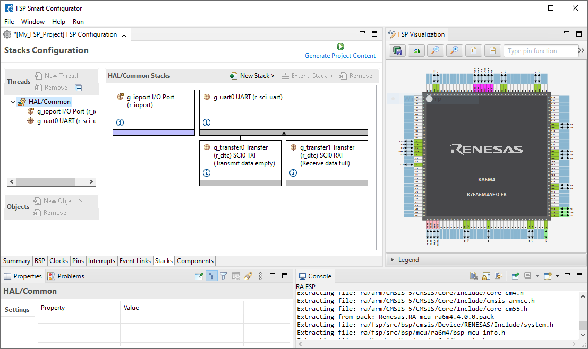

> 最新改进与 bug 修复见 RASC 的 Release Notes。

---

## 2. 前置条件

第三方 IDE 的版本要求，请对照你所用的 FSP 版本的 Release Notes 确认。

### 2.1 IAR EWARM ✘

要用 RASC 工程跑 IAR EWARM，需要：

- IAR EWARM 已安装并正确授权；
- 烧录/调试需要最新的 SEGGER J-Link DLL：运行  
  **SEGGER J-Link Software and Documentation Pack** 安装器，它会提示更新 J-Link DLL；
- 已按说明[把 RASC 工具加到 IAR EWARM IDE](#11-把-rasc-工具加到第三方-ide)。

### 2.2 Keil µVision（MDK）✘

- Keil MDK 与 **Arm Compiler for Embedded 6** 已安装并正确授权。  
  用旧版 Arm Compiler 6 会在构建时报 "unknown warning option"；
- Keil MDK 里装有与 FSP **同版本**的 RA Device Family Pack（DFP）：
  - 点击 [pack installer 图标](assets/rasc/keil_pack_installer.png)  
    打开 Keil Pack Installer，选 **File › Import…** 安装 DFP；
- 烧录/调试需要最新 SEGGER J-Link DLL（同上）；
- 已按说明[把 RASC 工具加到 Keil MDK IDE](#11-把-rasc-工具加到第三方-ide)。

### 2.3 CMake ★

要用 RASC 工程跑 CMake，需要：

- [CMake](https://cmake.org/) 已安装；
- **至少装了下面一种受支持的工具链**：
  - [Arm GNU Toolchain](https://developer.arm.com/downloads/-/arm-gnu-toolchain-downloads)（裸机目标）。  
    所需版本见 FSP Release Notes；
  - [LLVM/Arm Toolchain for Embedded](https://github.com/ARM-software/LLVM-embedded-toolchain-for-Arm)。  
    所需版本同样见 FSP Release Notes；
- [Ninja](https://ninja-build.org/) —— CMake 的**推荐**构建系统；
- 可选：装一个支持 CMake 集成的 IDE（例如 Visual Studio Code）。  
  VS Code 用户还需安装 Renesas 的 VS Code 扩展。

> **本项目现状**：Arm GNU 14.3.Rel1 + CMake 3.27.4 + Ninja 均已装好（见 `RA6E2开发环境.md` §4）。

---

## 3. 创建工程 ➖

启动 RASC 后会显示一个空的工作台（home screen）：

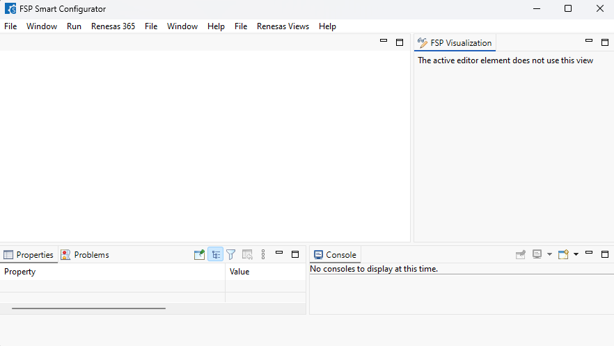

从 home screen 可以创建三类新工程：

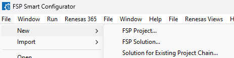

### 3.1 新建 FSP 工程（New FSP Project）

运行 RASC，走完 **New Renesas RA Project** 向导。向导里可以选择目标第三方 IDE，  
以及其它与本工程相关的选项。

选择 **File › New › FSP Project** 后显示向导第一页，在这里设置工程名与工程文件生成位置：

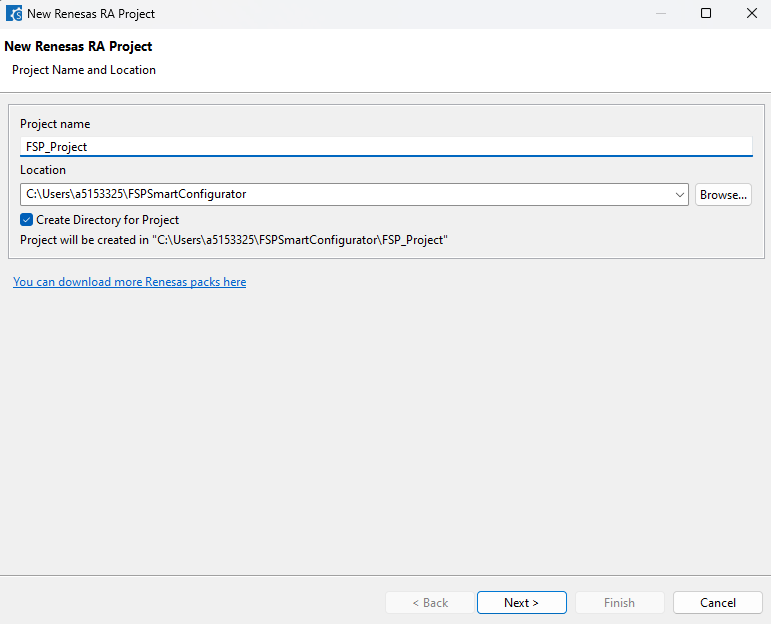

填好名字与位置后，点 **Next >** 进入下一页：

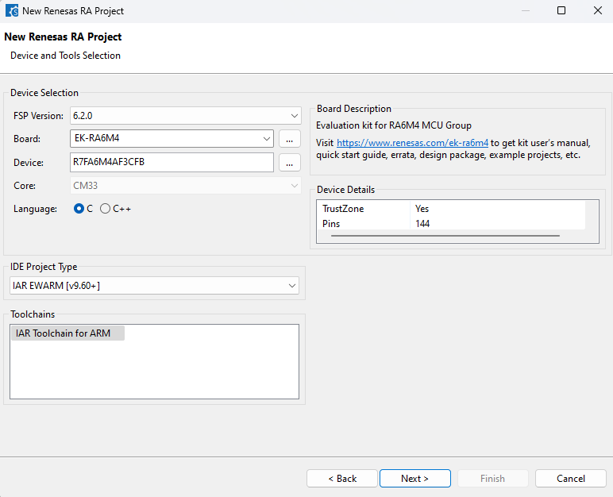

选择工程设置，例如所用的**板子**、**语言**、**目标第三方 IDE**。  
必填信息齐全后 **Next >** 才会可用，点它继续。

下一页选择**工程类型（project type）**：

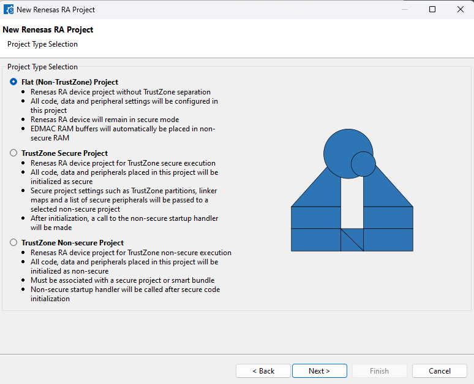

选好类型后点 **Next >**，进入 **smart bundle** 选择页：

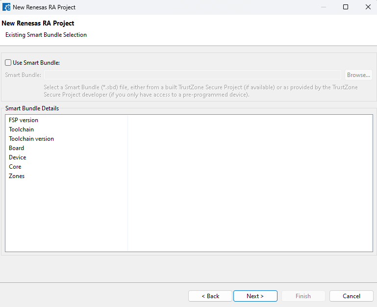

如果需要引用已有工程生成的 smart bundle 来构成**工程链**，勾选 **Use Smart Bundle**  
并 Browse 到那个 smart bundle。

选完后点 **Next >**，进入 **RTOS 选择**页：

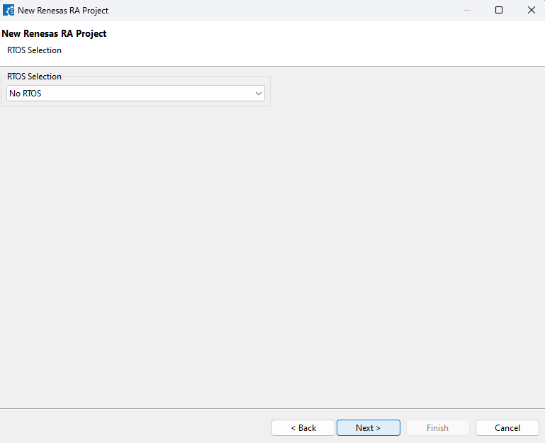

用下拉框选择工程要用的 RTOS（本项目选 **No RTOS**）。

选好后点 **Next >**，进入**工程模板选择**页：

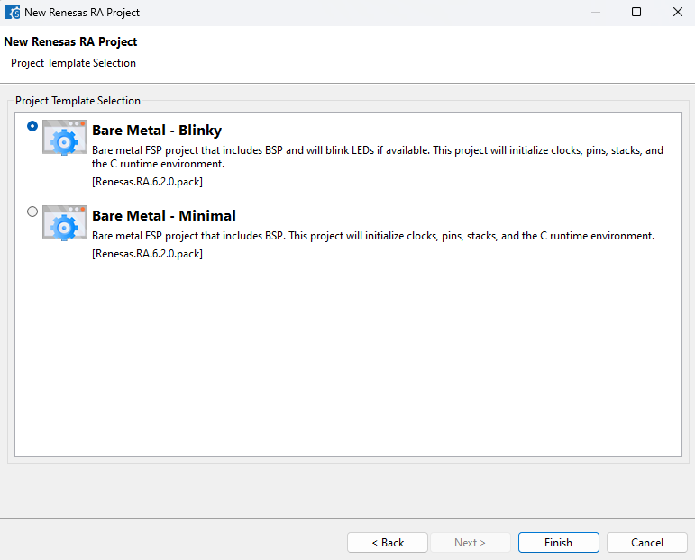

从模板列表里挑一个最合适的，点 **Finish >** 完成工程设置。

随后向导会按所选设置从模板创建工程并关闭，可能要花点时间，向导底部会显示进度条。  
生成完成后，smart configurator 会显示该工程的**摘要页**：

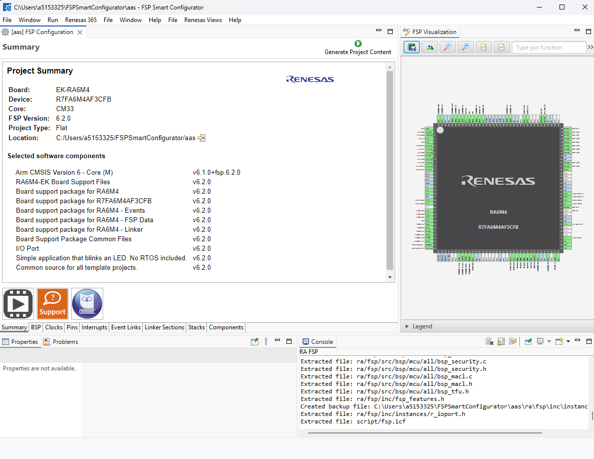

现在就可以在所选的第三方 IDE 里打开、构建、运行这个工程（见 §6）。  
用 Location 右侧的按钮可以在文件管理器里打开工程目录，再用你的 IDE 打开工程工作区。

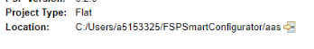

### 3.2 新建 FSP Solution 工程 ✘

#### 什么是 Solution 工程？

Solution 工程是一个**包含一整条相关联工程链全部信息**的工程。  
Solution 工程里的所有设置都会应用到工程链中的每一个工程。

#### 创建新的 Solution 工程

运行 RASC，走完 **New Renesas RA Solution Project** 向导，  
入口：**File › New › FSP Solution Project**。

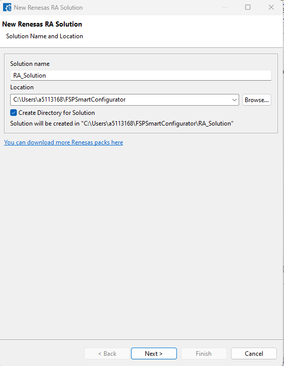

输入名字并点 **Next >** 后，向导让你选择目标第三方 IDE 以及其它选项。

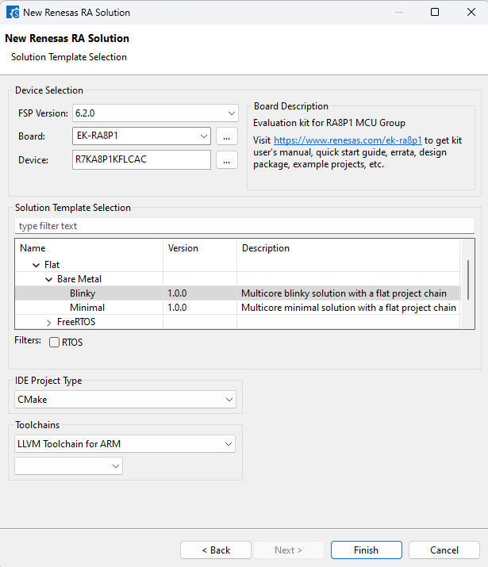

> ⚠ Solution 链里的每个工程都**依赖它的前一个工程**。因此某个工程更新后，  
> 可能需要按顺序重建后续工程。某些第三方 IDE 的构建系统对 RASC 生成的文件  
> 做增量构建并不可靠 —— 这种情况下建议**整体 clean 重建**以保证一致性。

#### 为已有的工程链创建 Solution 工程

运行 RASC，走完 **Solution for Existing Project Chain** 向导：选择一整条构成完整 FSP  
应用的工程链中的 smart bundle 来创建 solution。入口：  
**File › New › Solution for Existing Project Chain**。

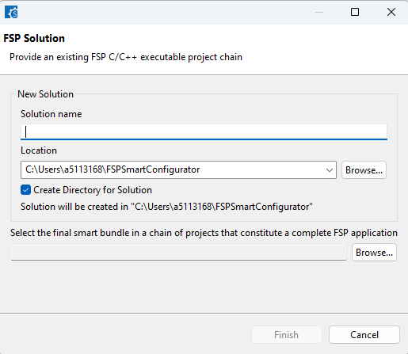

### 3.3 从已有 e²studio 工程导入 ➖

要把已有的 e²studio 工程转成 RASC 工程，运行 RASC 并走完 **Import Renesas FSP Project**  
向导：基于所选 e²studio 工程，为目标第三方 IDE 创建工程。入口：  
**File › Import › FSP Project**。

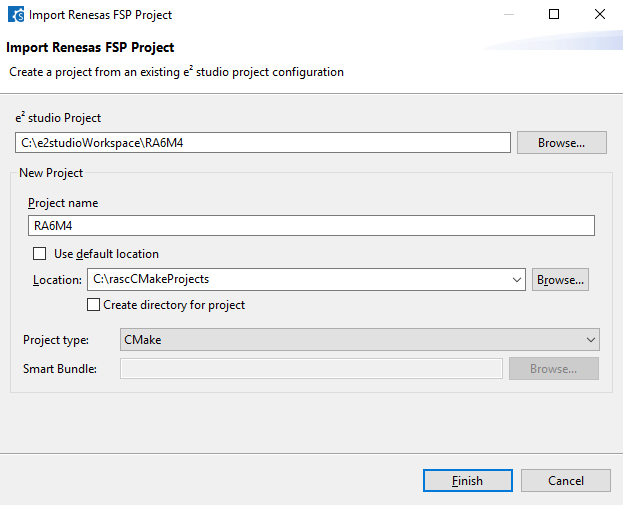

> **注意**：导入 **TrustZone Non-Secure** 工程时，需要在这里填入它所引用的 Smart Bundle，  
> 该 Smart Bundle 应来自**同类型的 TrustZone Secure 工程**。

也可以用命令行无头模式导入：

```bash
rasc -consoleLog --projectimport <e²studio 工程路径> <新 FSP 工程路径> <工程类型>
```

示例：

```bash
rasc -consoleLog --projectimport C:\e2studioWorkspace\RA6M4 C:\fspscIarProjects\ra6m4_iar "IAR EWARM [v9.60+]"
```

> **注意**：工程类型参数必须是 RASC UI 里列出的工程类型名之一。  
> 由于支持的第三方 IDE 会变，不同 RASC 版本的工程类型名可能略有差异。

---

## 4. 版本控制 ➖

RASC 生成的文件中，有一部分应当提交到版本控制。详见 RASC 文档中的  
「RASC Version Control」一节。

> 本项目做法：`projects/ra6e2_66_app/` 整体纳入 git，其中 `ra_gen/`、`ra_cfg/`、  
> `configuration.xml` 都必须提交（它们是配置源与生成物，缺一不可）；  
> `ra/`（FSP 源码，RASC 生成时拷入）体积大，按需决定是否提交。

---

## 5. 用 RASC 配置器件 ➖

关于如何用 RASC 配置器件，详见 RASC 文档中的「Using RASC」一节。  
Solution 的配置见「Using RASC Solution」。

---

## 6. 打开与构建

RASC 生成工程后，工程位置会显示在 FSP Configuration editor 的 **Project Summary** 页。  
可以用系统文件管理器打开工程目录，也可以点工具栏上的  


 按钮。

### 6.1 IAR EWARM 工程 ✘

RASC 会生成 IAR 工作区文件（`.eww`），双击即可打开，或在 IAR EWARM 里通过  
**File › Open Workspace…** 打开。打开后按 **F7** 或点工具栏  


 按钮构建。

### 6.2 Keil MDK 工程 ✘

RASC 会生成 µVision 多工程文件（`.uvmpw`）或 µVision 工程文件（`.uvprojx`），  
双击打开，或在 Keil MDK 里通过 **Project › Open Project…** 打开。

由多个 RASC 工程组成的 TrustZone 应用，**优先用 `.uvmpw`**。  
打开后按 **F7** 或点 


 按钮构建。

### 6.3 CMake 工程 ★

CMake 工程里带一个 **ReadMe** 文件作为配置与构建的快速入门。  
**必须先指定工具链路径**，三种方式任选其一：

**方式 1：用环境变量设置工具链路径**（推荐，只需设一次）  
可以在操作系统的用户环境变量里设，也可以在跑 CMake 的终端里设。

```bat
rem GCC：
set ARM_GCC_TOOLCHAIN_PATH=C:/13.2_rel1/bin

rem LLVM：
set ARM_LLVM_TOOLCHAIN_PATH=C:/LLVM-21.1.1/bin
```

**方式 2：用 CMake 参数传入**

```bash
cmake -DARM_TOOLCHAIN_PATH="C:/13.2_rel1/bin" ...
cmake -DARM_TOOLCHAIN_PATH="C:/LLVM-21.1.1/bin" ...
```

**方式 3：编辑 `Config.cmake`**  
该文件可以包含工具链路径以及其它用户覆盖设置：

```cmake
set(CMAKE_FIND_ROOT_PATH "C:/13.2_rel1/bin")
```

> **注意**：工具链路径和工程路径**尽量避免空格** —— CMake 和其它构建工具  
> 可能把空格当成分隔符。

#### 用 VS Code 打开 ➖

VS Code 用户可以这样打开 CMake 工程：

- **File › Open Folder**，或在文件管理器里右键工程目录；
- Windows 上选 **Open with Code**；
- Linux 上选 **Open With Other Application › Visual Studio Code**。

启动 VS Code 前，确保工具链路径环境变量已经设好。也可以从命令行启动：

```bat
set ARM_GCC_TOOLCHAIN_PATH=/path/to/toolchain/bin
cd /path/to/project/directory
code .
```

如果 VS Code 提示选择工具链，选 **ARM GCC - Ninja** 或 **ARM LLVM - Ninja** kit，  
让 CMake 用上你已配置的工具链：

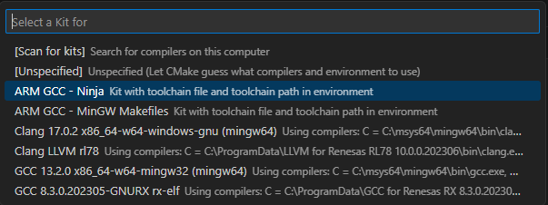

之后可以通过 CMake 状态栏配置并构建工程：

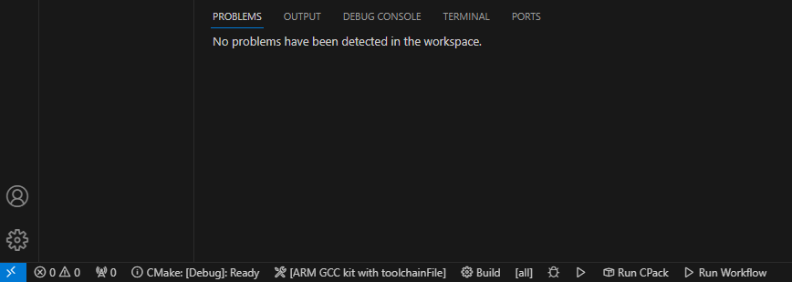

在状态栏上可以选构建变体（Debug、Release…）、点构建按钮构建、点调试按钮启动调试。

#### 命令行构建 ★

Windows（命令提示符）：

```bat
cd C:\path\to\project\directory
set ARM_GCC_TOOLCHAIN_PATH="/your/gcc/toolchain/path"
cmake -DCMAKE_TOOLCHAIN_FILE=cmake/gcc.cmake -G Ninja -B build/Debug
cmake --build build/Debug
```

Linux（终端）：

```bash
cd /path/to/project/directory
ARM_LLVM_TOOLCHAIN_PATH="/your/llvm/toolchain/path"
cmake -DCMAKE_TOOLCHAIN_FILE=cmake/llvm.cmake -G Ninja -B build/Release
cmake --build build/Release
```

> **注意**：如果不在**工程主目录**下构建，可能会遇到构建错误。

#### 加入自定义源文件与头文件路径 ★

想给 CMake 工程添加自己的源码和包含路径，在 `CMakeLists.txt` 里这样写：

```cmake
include(${CMAKE_CURRENT_LIST_DIR}/cmake/GeneratedSrc.cmake)

# 你的自定义包含目录
target_include_directories(${PROJECT_NAME}.elf
    PRIVATE
    ${CMAKE_CURRENT_SOURCE_DIR}/src/sub_dir1
)
```

> **本项目做法**：我们没有用 RASC 生成的 `CMakeLists.txt`（它依赖 `GeneratedSrc.cmake`  
> 与 `Config.cmake` 那套机制），而是自己写了一份 —— 用 `file(GLOB_RECURSE)` 收集  
> FSP 源码与 `src/`，并显式列出 include 目录。详见 `RA6E2的开发文档.md` §3.3。

---

## 7. 修改已有的 RA 配置

工程已经在第三方 IDE 里打开并构建之后，常常还要回去改 FSP 配置。  
做法是**为当前工程重新启动 RA Smart Configurator**，按下面各 IDE 的说明操作。  
改完 FSP 配置后，**务必点击**


**Generate Project Content** 按钮；  
IDE 会自动检测到工程变化，之后即可重新构建。

### 7.1 IAR EWARM ✘

- 如尚未配置，先[把 RASC 工具加到 IAR EWARM IDE](#11-把-rasc-工具加到第三方-ide)；
- 在 IDE 中打开工程，从 **Tools** 菜单选 **RA Smart Configurator**；
- 用 FSP Configuration editor 做所需修改；
- 关闭 RASC 回到 IAR EWARM 前，**务必点 Generate Project Content**。

### 7.2 Keil MDK ✘

- IDE 里打开工程，点工具栏  
  [RTE 图标](assets/rasc/keil_manage_rte.png) 打开 **Manage Run-Time Environment** 对话框；
- 展开 **Flex Software**，点击 **RA Configuration** 旁边的  
  [launch 图标](assets/rasc/keil_manage_rte_launch.png) 按钮：

  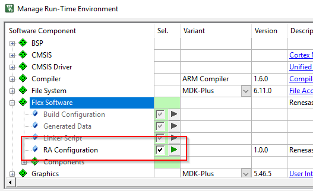
- 若提示选择，选对应的 RA Smart Configurator；
- 用 FSP Configuration editor 做修改；
- 回到 Keil MDK 前，**务必点 Generate Project Content**。

### 7.3 Visual Studio Code ➖

- IDE 里打开工程，选 **Terminal › Run Task…**；
- 从列表里选 **FSP Smart Configurator** 任务（它会调用 CMake 的“打开配置文件”构建目标）：

  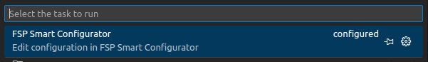

  该目标也可以通过 VS Code 的 CMake 扩展构建：

  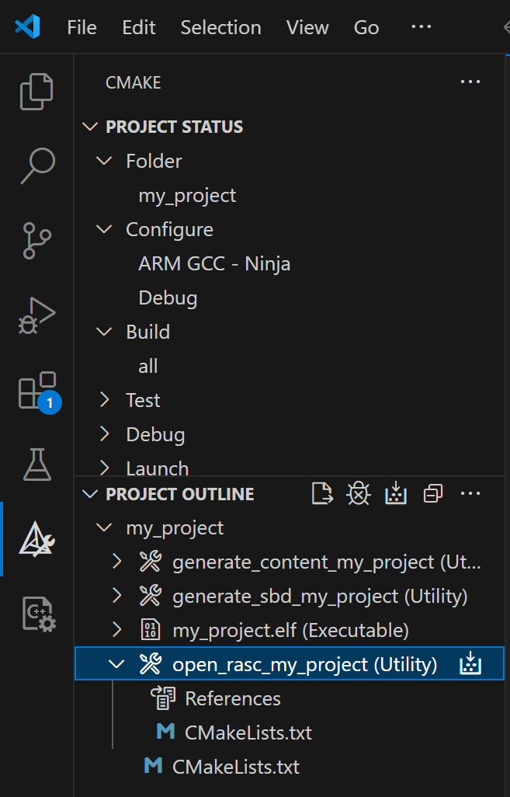
- 另一种方式：右键工程根目录的 `configuration.xml`，  
  在右键菜单里选 **Open with Smart Configurator**：

  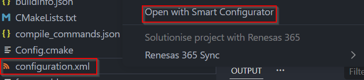

  再从列表里选 **Smart Configurator**：

  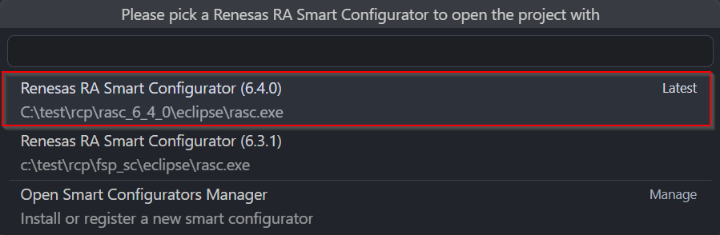
- 用 FSP Configuration editor 做修改；
- 回到 VS Code 前，**务必点 Generate Project Content**。


### 7.4 CMake（命令行）★

命令行用户可以在 Windows 命令提示符里这样改 CMake 工程的 FSP 配置：

```bat
cd C:\path\to\project\directory
cmake --build build/Debug --target open_rasc_${projectName}
```

Linux 终端：

```bash
cd /path/to/project/directory
cmake --build build/Debug --target open_rasc_${projectName}
```

关闭 RASC 回到 IDE 前，**务必点 Generate Project Content**。

> **本项目做法**：我们不用 `open_rasc_*` 目标（那是 RASC 生成的 CMakeLists 才有的），  
> 而是**直接跑命令行生成**，见 §8 与 §14。

---

## 8. 带 FSP 组件的无头构建（Headless build）★

RASC 有些操作必须在源码编译**之前**完成，有些则在链接**之后**才需要。  
这些通过命令行调用 RASC 实现：主构建前用 `--generate`，主构建后用 `--gensmartbundle`。  
命令行本身由 RASC 生成，并插入到所用 IDE 的构建流程中。

> 虽然很多这类操作与安全模式（secure）有关，但它们**并非 TrustZone 器件独有**。

> **注意**：如果 FSP 配置已完成且没变（smart bundle 文件与 `configuration.xml` 都没动过），  
> **可以省略构建前这一步**。

### 8.1 构建前动作（`--generate`）★

构建前这一步会**基于当前配置重新生成所有 FSP 工程文件**，包括：

- CMSIS 组件评估（component evaluation）
- 从 pack 中提取相关源文件
- 生成 `memory_regions.ld`（EWARM 里叫 `memory_regions.icf`，µVision 里叫 `memory_regions.scat`）
- 更新 IDE 配置文件（EWARM 的 `.ipcf`）
- 生成 FSP 模块实例数据，例如 `hal_data.c`
- 生成 `secure.o` 安全网关导入库（TrustZone 工程才有）

### 8.2 构建后动作 ➖

构建后这一步会重新生成 **SmartBundle（`.sbd`）** 文件，  
其中含有供下游工具（如调试器）以及工程链中后续工程使用的链接信息。

---

## 9. 为 TrustZone 器件工程启动调试会话 ✘

在调试 TrustZone 器件的工程之前，可能需要**修改目标器件的内存分区大小**。  
按下面各 IDE 的说明修改分区大小并启动调试会话。

### 9.1 IAR EWARM

- 在 IAR EWARM 里照常启动调试会话，**分区大小会自动检查**：
  - 若分区大小符合要求，调试会话直接开始，无需用户额外配置；
  - 若需要改动，IAR EWARM 会提示运行 **Renesas Device Partition Manager**，选 **Yes**。
- Device Partition Manager 启动时会预填所需的分区大小；
- 只勾选 **Set TrustZone secure/non-secure boundaries** 这一项动作；
- 按需填写调试器信息；
- 点 **Run** 烧写分区；
- 点 **Close** 回到 IDE；
- 重新启动调试会话。

### 9.2 Keil µVision（MDK）

- 如尚未配置，先[把 RASC 工具加到 Keil MDK IDE](#11-把-rasc-工具加到第三方-ide)；
- 在 Keil MDK 里，若当前工程的目标器件支持 TrustZone，选  
  **Tools › Device Partition Manager**；
- Device Partition Manager 启动时会预填所需的分区大小；
- 只勾选 **Set TrustZone secure/non-secure boundaries**；
- 按需填写调试器信息；
- 点 **Run** 烧写分区；
- 点 **Close** 回到 IDE；
- 启动调试会话。

---

## 10. 调试多核 Solution ✘

创建 solution 时，RASC 会加入多核调试所需的配置，各第三方 IDE 的设置不同。

> 本节不是第三方 IDE 的使用教程，深入用法请查阅所用 IDE 的文档。

### 10.1 IAR EWARM

为 EWARM 创建 solution 时，除了 solution 与各核的工程外，  
还会额外创建一个 **Attach** 工程：

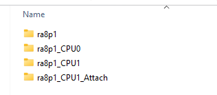

Attach 工程用于让**多个 EWARM 实例**同时打开该 solution 进行调试，**不要修改它**。

> EWARM 的限制：同一个工程不能被多个 EWARM 实例同时打开。

#### 启动调试会话

1. 用 RASC 为 **EK-RA8P1** 创建一个面向 EWARM 的新 solution，用 multicore blinky 模板；
2. 双击主 solution 工程里的 `.eww`（工作区）文件，用 EWARM 打开；
3. 用 **Project › Batch build** 触发整组工程构建：

   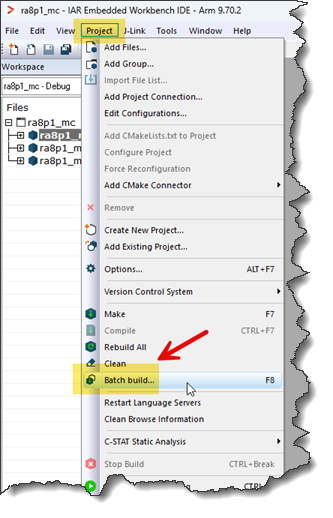
4. 在弹出的 Batch Build 对话框里按 **Make** 开始构建：

   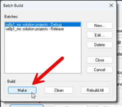
   > **注意**：可能会显示多个构建目标（如 Debug 和 Release），**应选 Debug**。
5. 构建完成后、开始调试前，确认 **…CPU0 – Debug** 被设为活动配置：

   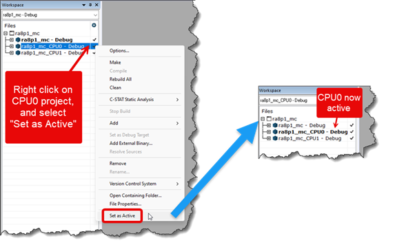
   > ⚠ **复位 TrustZone 分区边界**：目前 EWARM 调试多核应用时**不支持**在 MCU 内部  
   > 配置 TrustZone 分区边界。因此首次调试多核应用前，必须先用 **RFP 或 RDPM**  
   > 对 MCU 做一次 initialize 操作，确保整片 Flash（MRAM）被标记为 secure。  
   > 否则镜像下载与调试启动可能不正常。FSP/RASC 后续版本会改进这一点。
6. 点 EWARM 工具栏上的 **Download and Debug** 按钮启动调试会话：

   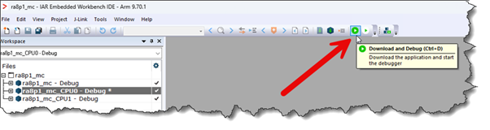

   这会启动到 CPU0 的调试会话，同时自动为 CPU1 启动第二个 EWARM 实例  
   （使用 RASC 创建的 Attach 工程）。
7. 调试启动完成后会看到两个 EWARM 实例：

   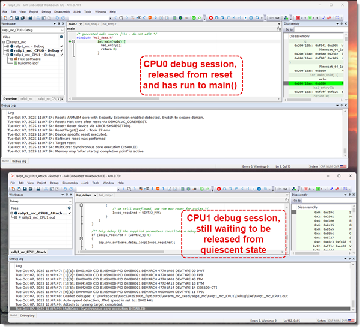
8. 在 CPU0 实例里 step into `hal_entry()`，一路执行到调用 `R_BSP_SecondaryCoreStart()`：

   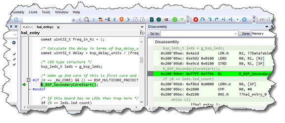

   step over 这个调用后，CPU1 就被完全激活并开始执行代码。  
   此时 **LED2** 会开始闪烁（由 CPU1 驱动），CPU1 也完全可用。
9. 在 CPU0 实例里点 **Go** 让 CPU0 继续运行，**LED1** 也会开始闪烁（由 CPU0 驱动）。
   > 两个 EWARM 实例的工具栏末尾都多了一组按钮（**multicore toolbar**），  
   > 可以从任一实例控制两个核：
   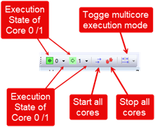
   > **Toggle multicore execution mode** 按钮用来设置常规调试控件  
   > （如单步）是控制单个核还是两个核。
10. **View › Cores** 视图可以显示各核状态摘要：

    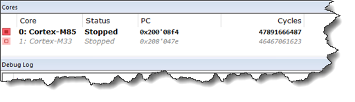

### 10.2 Keil MDK

1. 用 RASC 为 **EK-RA8P1** 创建一个面向 Keil µVision（MDK）的新 solution，  
   用 multicore blinky 模板；
2. 双击主 solution 工程里的 `.uvmpw` 用 MDK 打开；
3. 用 **Project › Batch build** 触发整组工程构建：

   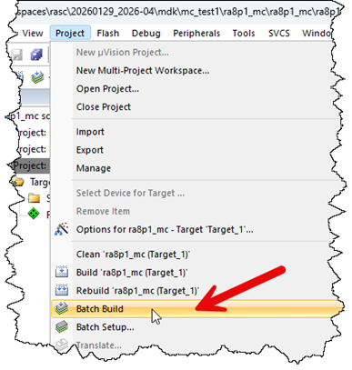
   > ⚠ 同 EWARM：首次调试多核应用前必须用 **RFP 或 RDPM** 对 MCU 做 initialize，  
   > 确保整片 Flash（MRAM）标记为 secure，否则下载与调试启动可能异常。
4. 构建完成后、调试前，确认 **…CPU0** 为活动配置：

   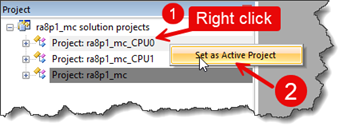
5. 点 MDK 工具栏的 **Start/Stop Debugging Session** 启动调试：

   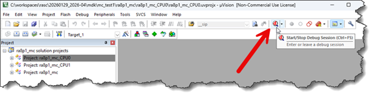
6. 此时停在 CPU0 应用的 `main()`：

   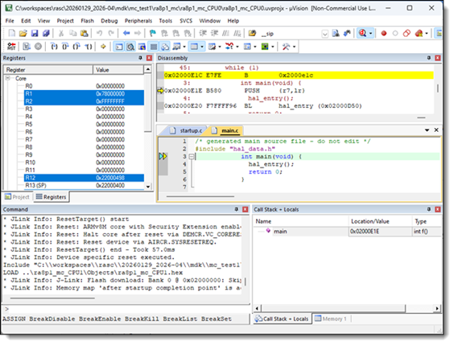
7. 点 **Run**：

   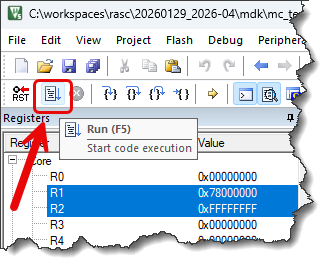

   程序进入 `hal_entry()`，内联函数 `R_BSP_SecondaryCoreStart()` 被调用，  
   CPU1 从复位中释放。**LED2**（CPU1）与 **LED1**（CPU0）都会开始闪烁。

#### 调试 CPU1

CPU1 已完全激活，可以连上去调试。

> µVision 对多核调试的支持有限 —— 例如无法在同一实例里启动第二个调试会话。  
> 因此要调试 CPU1，**必须再开一个 µVision 实例**（并加载对应工程）。

- 双击 CPU1 工程目录里的 `.uvprojx` 打开第二个 MDK：

  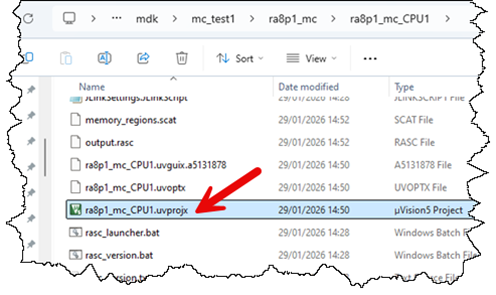
- 确保这个 µVision 会话**只包含 CPU1 工程**（不要加载整个 solution）：

  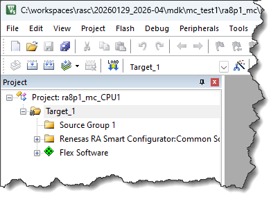
- 点工具栏 **Start/Stop Debug Session** 启动 CPU1 调试：

  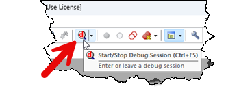
- 这会启动一个 **“attach-only”** 调试会话，CPU1 停在当时所在的位置  
  （blinky 类应用多半停在延时循环里）：

  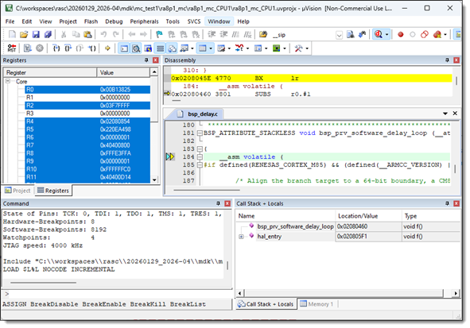

  此时 CPU0 驱动的 LED1 继续闪烁，CPU1 驱动的 LED2 停止闪烁。
- 现在两个核各有一个独立调试会话，可以对它们各自做常规 µVision 调试操作  
  （暂停、单步、查看寄存器等）。

---

## 11. 把 RASC 工具加到第三方 IDE ✘

为了能从第三方 IDE 里直接启动 RA Smart Configurator、Smart Bundle Viewer 和  
Device Partition Manager（TrustZone 分区），可以把它们作为外部“工具”加入 IDE。

### 11.1 IAR EWARM

- 选 **Tools › Configure Tools…**；
- 点 **New**，为每个工具填写如下字段：

**RA Smart Configurator**

| 字段                | 值                       |
| ----------------- | ----------------------- |
| Menu Text         | `RA Smart Configurator` |
| Command           | `$RASC_EXE_PATH$`       |
| Argument          | `configuration.xml`     |
| Initial Directory | `$PROJ_DIR$`            |

**Smart Bundle Viewer**

| 字段                | 值                                                  |
| ----------------- | -------------------------------------------------- |
| Menu Text         | `Smart Bundle Viewer`                              |
| Command           | `$RASC_EXE_PATH$`                                  |
| Argument          | `-nosplash --viewsmartbundle "$TARGET_BPATH$.sbd"` |
| Initial Directory | `$PROJ_DIR$`                                       |

**Device Partition Manager**

| 字段                | 值                                                                                           |
| ----------------- | ------------------------------------------------------------------------------------------- |
| Menu Text         | `Device Partition Manager`                                                                  |
| Command           | `$RASC_EXE_PATH$`                                                                           |
| Argument          | `-application com.renesas.cdt.ddsc.dpm.ui.dpmapplication configuration.xml "$TARGET_PATH$"` |
| Initial Directory | `$PROJ_DIR$`                                                                                |

### 11.2 Keil MDK

- 选 **Tools › Customize Tools Menu…**；
- 点 **New** 图标，为每个工具填写如下字段：

**RA Smart Configurator**

| 字段              | 值                       |
| --------------- | ----------------------- |
| Menu Content    | `RA Smart Configurator` |
| Command         | `C:\path\to\rasc.exe`   |
| Initial Folder  | `$P`                    |
| Arguments       | `configuration.xml`     |
| Run Independent | ☑                       |

**Smart Bundle Viewer**

| 字段              | 值                                        |
| --------------- | ---------------------------------------- |
| Menu Content    | `Smart Bundle Viewer`                    |
| Command         | `C:\path\to\rasc.exe`                    |
| Initial Folder  | `$P`                                     |
| Arguments       | `-nosplash --viewsmartbundle "$L@L.sbd"` |
| Run Independent | ☑                                        |

**Device Partition Manager**

| 字段              | 值                                                                                  |
| --------------- | ---------------------------------------------------------------------------------- |
| Menu Content    | `Device Partition Manager`                                                         |
| Command         | `C:\path\to\rasc.exe`                                                              |
| Initial Folder  | `$P`                                                                               |
| Arguments       | `-application com.renesas.cdt.ddsc.dpm.ui.dpmapplication configuration.xml "$L%L"` |
| Run Independent | ☑                                                                                  |

---

## 12. Renesas Device Partition Manager ✘

Renesas Device Partition Manager 用于在调试**前**配置 TrustZone 器件。  
它可以对 TrustZone 器件执行以下操作：

- 读取当前器件信息
- 改变器件生命周期管理（DLM）状态
- 设置 TrustZone secure / non-secure 边界
- 把器件初始化回出厂默认状态

详见文档中的「Partition Manager」一节。

---

## 13. RASC 命令行选项 ★

RASC 命令行选项用于**改变 RASC 的行为**，主要服务于持续集成（CI）  
以及从第三方 IDE 调用。

> 命令名说明：官方文档里 `rasc` 与 `rascc` 混用，  
> **本机实际可执行文件是 `E:\software\Renesas\RAC\eclipse\rascc.exe`**（CLI 版，不弹 GUI）。

### 13.1 选项速查表

| 选项                                                        | 说明                                                                                            |
| --------------------------------------------------------- | --------------------------------------------------------------------------------------------- |
| `--boardid`                                               | 板卡 ID。仅与 `--generatesolution` 配合使用；传 `?` 打印可用板卡 ID 列表，否则指定要用的板卡 ID                            |
| `--boardname`                                             | 板卡名。仅与 `--generatesolution` 配合；传 `?` 打印列表，否则指定板卡名                                             |
| `--compiler`                                              | 指定编译器类型。**默认 `ARMv6`**。可选：`GCC`、`IAR`、`ARMv6`、`GCCRX`、`CCRX`、`CCRL`、`LLVMARM`、`CCRH`、`IAR_RX` |
| `--cplusplus`                                             | 生成 C++ 代码                                                                                     |
| `--daemon`                                                | 以守护进程（daemon）方式启动工具                                                                           |
| `--debug`                                                 | 连接 daemon 出错时显示额外的错误信息                                                                        |
| `--device`                                                | 指定允许的目标器件名前缀                                                                                  |
| `--devicefamily`                                          | 启动工具并打开对应器件系列的工程创建模板向导                                                                        |
| `--devicename`                                            | 器件名。仅与 `--generatesolution` 配合                                                                |
| `--edit`                                                  | 以**编辑模式**启动（默认模式）                                                                             |
| `--extractsupportfiles`                                   | 把支持文件提取到该选项指定的目录 `{0}`                                                                        |
| `--fspversion`                                            | FSP 版本。仅与 `--generatesolution` 配合；传 `?` 打印可用版本列表                                              |
| `--fspversions`                                           | 打印当前 FSP Smart Configurator 已安装的 FSP 版本列表                                                     |
| `--generate`                                              | **生成模式**：基于现有 `configuration.xml` 自动生成所有目录与文件                                                 |
| `--generatesolution`                                      | 从命令行生成 solution 工程                                                                            |
| `--gensmartbundle`                                        | 生成 SmartBundle 模式：自动生成 smart bundle 并退出。（取代已废弃的 `--gensecurebundle`）                          |
| `--gensmartbundleandpartition`                            | 先生成 smart bundle，再进入 partition 模式，输出从 smart bundle 得到的内存分区并退出。**仅 RA 系列支持**                   |
| `--gensolutionbundle`                                     | 生成 solution 的 smart bundle 并退出                                                                |
| `--help`                                                  | 显示 rasc 定义的所有命令行选项                                                                            |
| `--ideprojecttypeid`                                      | IDE 工程类型 ID。仅与 `--generatesolution` 配合；`?` 打印列表                                               |
| `--ideprojecttypename`                                    | IDE 工程类型名。仅与 `--generatesolution` 配合；`?` 打印列表                                                 |
| `--ipcf`                                                  | IAR Project Connection 输出文件                                                                   |
| `--keepfiles`                                             | 取消勾选组件时**保留**该组件的文件                                                                           |
| `--nokeepfiles`                                           | 取消勾选组件时**删除**该组件的文件                                                                           |
| `--packcreate`                                            | pack 创建模式：创建 pack 并退出                                                                         |
| `--partition`                                             | partition 模式：输出从 smart bundle 得到的已分配内存区域并退出                                                   |
| `--ping`                                                  | ping daemon 测试其响应                                                                             |
| `--port <PORT>`                                           | daemon 监听端口，`0` 表示自动（默认 0）                                                                    |
| `--preference`                                            | 设置某个 preference 选项值并退出（仅 daemon 模式）                                                           |
| `--projectdir`                                            | 定义构建设置输出文件（默认：`configuration.xml` 所在目录）                                                       |
| `--projectimport`                                         | 工程导入模式：从已有 e²studio FSP 工程导入配置，创建新 IDE 工程并退出                                                  |
| `--projectname`                                           | 启动工具并在工程生成向导里指定工程名                                                                            |
| `--projectresource`                                       | 工程资源与成员文件                                                                                     |
| `--newfspproject`                                         | 以“新建 FSP 工程”向导启动                                                                              |
| `--newsolution`                                           | 以“新建 solution”向导启动                                                                            |
| `--shutdown`                                              | 向 daemon 发送退出命令                                                                               |
| `--srcdir`                                                | 相对于工程目录、生成用户源码的目录（默认 `src`）                                                                   |
| `--templatefile`                                          | solution 模板文件。仅与 `--generatesolution` 配合；`?` 打印列表                                             |
| `--templateid`                                            | solution 模板 ID。仅与 `--generatesolution` 配合；`?` 打印列表                                            |
| `--toolchainid`                                           | 工具链 ID。仅与 `--generatesolution` 配合；`?` 打印列表                                                    |
| `--toolchainname`                                         | 工具链名。仅与 `--generatesolution` 配合；`?` 打印列表                                                      |
| `--toolchainversion`                                      | 指定工具链版本                                                                                       |
| `--validate`                                              | 校验模块描述文件中的元素是否与 FSP packs 中的元素一致                                                              |
| `--viewsmartbundle`                                       | 以 smart bundle viewer 模式启动并退出                                                                 |
| `-application com.renesas.cdt.ddsc.dpm.ui.dpmapplication` | 启动 Renesas Data Partition Manager，参数为 Renesas Partition Data 文件                               |
| `-consoleLog`                                             | 把日志输出到控制台（配合其它选项使用）                                                                           |
| `-nosplash`                                               | 不显示启动画面（无头场景基本必带）                                                                             |
| `--launcher.suppressErrors`                               | 抑制 launcher 的错误弹窗（CI 场景常用）                                                                    |


### 13.2 常用选项的语法与示例

**`--boardid`**

```bash
rascc -nosplash --launcher.suppressErrors --generatesolution --fspversion <版本> --boardid <id>
```

```bash
# 打印 FSP 6.0.0 可用的板卡 ID 列表
rascc -nosplash --launcher.suppressErrors --generatesolution --fspversion 6.0.0 --boardid ?

# 指定 EK-RA6M5 板
rascc -nosplash --launcher.suppressErrors --generatesolution --fspversion 6.0.0 --boardid board.ra6m5ek
```

**`--boardname`**

```bash
rascc -nosplash --launcher.suppressErrors --generatesolution --fspversion <版本> --boardname <名字>
```

```bash
rascc -nosplash --launcher.suppressErrors --generatesolution --fspversion 6.0.0 --boardname ?
rascc -nosplash --launcher.suppressErrors --generatesolution --fspversion 6.0.0 --boardname EK-RA6M5
```

**`--compiler`** ★

```bash
rascc --compiler <编译器类型>
```

**`--daemon` / `--debug` / `--shutdown` / `--ping` / `--port`**

```bash
rasc --daemon [OPTIONS]
rascc --ping [OPTIONS]
```

**`--device`** ★

```bash
rascc --device <NAME>
```

**`--devicefamily`**

```bash
--devicefamily <器件系列>

# 示例：为 RA 系列打开模板向导
rasc.exe --devicefamily ra
```

**`--devicename`**

```bash
rascc -nosplash --launcher.suppressErrors --generatesolution --devicename <器件名>

# 示例
rascc -nosplash --launcher.suppressErrors --generatesolution --devicename R7FA6M4AD2CBQ
```

**`--edit`**

```bash
rascc --edit [OPTIONS] CONFIGURATIONXML
```

**`--extractsupportfiles`**

```bash
rascc --extractsupportfiles [OPTIONS] EXTRACTDIR
```

**`--fspversion`**

```bash
rascc -nosplash --launcher.suppressErrors --generatesolution --fspversion <值>

# 打印可用版本列表
rascc -nosplash --launcher.suppressErrors --generatesolution --fspversion ? 2> rasc_cmd_log.txt

# 指定 6.0.0
rascc -nosplash --launcher.suppressErrors --generatesolution --fspversion 6.0.0
```

**`--fspversions`**

```bash
rascc -nosplash --fspversions
```

**`--generate`** ★（本项目核心用法）

以生成模式启动：工具会基于现有 `configuration.xml` **自动生成所有目录与文件**。

```bash
rasc -nosplash --devicefamily <器件系列> --compiler <编译器名> --generate <configuration.xml 路径>
```

示例：把一份 `configuration.xml` 拷到空目录，在命令提示符里执行：

```bash
rascc -nosplash --devicefamily ra --compiler IAR --generate <configuration.xml 路径>
```

打开目标目录，会看到 `buildinfo.ipcf` 文件以及 `ra`、`ra_cfg`、`ra_gen`、`script`、`src` 文件夹。

> 注意：根据 `configuration.xml` 里的信息，用户需自行填入合适的器件系列与编译器。

**`--generatesolution`**

```bash
rascc -nosplash --launcher.suppressErrors --generatesolution [Options]
```

**`--gensmartbundle`**

```bash
rascc -nosplash --launcher.suppressErrors --gensmartbundle [Options]
```

```bash
# EWARM 工程的构建后命令示例
rascc -nosplash --launcher.suppressErrors --gensmartbundle --compiler IAR --devicefamily ra \
    "<configuration.xml 路径>" "<project.out 路径>" 2> "<.rasc_stderr.txt 路径>"
```

期望结果：生成一个 `.sbd` 文件。

**`--gensmartbundleandpartition`**

```bash
rascc -nosplash --launcher.suppressErrors --gensmartbundleandpartition [Options]
```

```bash
rascc -nosplash --launcher.suppressErrors --gensmartbundleandpartition --compiler IAR --devicefamily ra \
    "<configuration.xml 路径>" "<project.out 路径>" \
    > "<.rasc_stdout.txt 路径>" 2> "<.rasc_stderr.txt 路径>"
```

期望结果：生成 `.sbd` 文件，分区信息输出到 `.rasc_stdout.txt`。

**`--gensolutionbundle`**

```bash
rascc --gensolutionbundle [OPTIONS] SOLUTIONXML
```

**`--help`**

```bash
rascc.exe -nosplash --help
```

**`--ideprojecttypeid` / `--ideprojecttypename`**

```bash
rascc -nosplash --launcher.suppressErrors --generatesolution --fspversion <版本> --ideprojecttypeid <ID>
rascc -nosplash --launcher.suppressErrors --generatesolution --fspversion <版本> --ideprojecttypename <名字>
```

```bash
# CMake 工程类型（按类型名指定）
rascc -nosplash --launcher.suppressErrors --generatesolution --fspversion 6.0.0 --ideprojecttypename CMake

# CMake 工程类型（按 ID 指定）
rascc -nosplash --launcher.suppressErrors --generatesolution --fspversion 6.0.0 \
    --ideprojecttypeid com.renesas.cdt.ddsc.project.idegeneric.cmake.projecttype
```

**`--ipcf` / `--projectresource` / `--projectdir` / `--srcdir`**

```bash
rascc --ipcf <File>
rascc --projectresource <PROJECTRESOURCE>
rascc --projectdir <DIR>
rascc --srcdir <DIR>
```

**`--partition`**

```bash
rascc --partition [OPTIONS] CONFIGURATIONXML PROJECTEXE
rascc --partition [OPTIONS] SOLUTIONXML
```

```bash
rascc -nosplash --launcher.suppressErrors -partition "<configuration.xml 路径>" "<ptj_name.out 路径>"
```

期望结果：控制台显示从 smart bundle 得到的已分配内存区域。

**`--projectimport`**

```bash
rascc --projectimport [OPTIONS] PROJECTTEMPLATENAME NEWPROJECTNAME NEWPROJECTTYPE
```

完整示例（见 §3.3）：

```bash
rasc -consoleLog --projectimport C:\e2studioWorkspace\RA6M4 C:\fspscIarProjects\ra6m4_iar "IAR EWARM [v9.60+]"
```

**`--newfspproject` / `--newsolution` / `--projectname`**

```bash
rascc -nosplash --newfspproject --devicefamily ra --device R7FA4M1AB3CFP
rascc -nosplash --newsolution
rascc --projectname <Project_Name>
```

**`--packcreate` / `--validate` / `--viewsmartbundle`**

```bash
rascc --packcreate [OPTIONS] CONFIGURATIONXML

# 校验 XML
rascc -consoleLog --validate 4.0.0 "PATH_TO_ATTACHED_XML_FILE" ra

# 打开 smart bundle viewer
rascc -nosplash --viewsmartbundle "Path to .sbd file"
```

**Device Partition Manager（应用方式）**

```bash
rascc -application com.renesas.cdt.ddsc.dpm.ui.dpmapplication "Path to FSP_Project_IAR.rpd"
```

### 13.3 互斥选项 ⚠

下列命令行选项**不能同时使用**：

- `--edit`
- `--generate`
- `--extractsupportfiles`
- `--gensecurebundle`
- `--gensmartbundle`
- `--gensmartbundleandpartition`
- `--newfspproject`
- `--newsolution`
- `--viewsmartbundle`
- `--partition`
- `--packcreate`
- `--projectimport`
- `--preference`
- `--fspversions`

---

## 14. 本项目实际用法（速查）★

这一节不是翻译，是**本项目在用的最小流程**，把上面零散章节串起来。

### 14.1 一条龙命令

```bash
# 1) 准备底稿：取 BH1750 的 configuration.xml（它带 IIC + UART + IOPORT）
mkdir -p projects/ra6e2_66_app
cp "<资料>/3、程序/DQX_RA6E2/BH1750/configuration.xml" projects/ra6e2_66_app/

# 2) 改版本号与 CMSIS 组件分组，否则 RASC 6.6.0 不认
cd projects/ra6e2_66_app
sed -i 's/5\.8\.0/6\.6\.0/g; s/group="CMSIS5"/group="Main"/g' configuration.xml

# 3) 无头生成（★ 核心命令）
"/e/software/Renesas/RAC/eclipse/rascc.exe" --generate \
    --compiler GCC --device R7FA6E2BB configuration.xml

# 4) 用我们自己的 CMakeLists 构建（src/ 不动）
cd /e/REA6E2_Dev
cmake -B build -DFSP_ROOT="E:/REA6E2_Dev/projects/ra6e2_66_app"
cmake --build build

# 5) 烧录 + 复位（烧完必须 reset 才会跑）
./scripts/flash.sh --verify
probe-rs reset --chip R7FA6E2BB --probe 0d28:0204
```

### 14.2 生成产物

`rascc --generate` 之后，工程目录里会出现：

| 产物                  | 说明                                                                          |
| ------------------- | --------------------------------------------------------------------------- |
| `ra/`               | FSP 源码（按本工程用到的模块拷贝进来）—— **编译只认这一份**                                         |
| `ra_gen/`           | 配置生成代码：`hal_data.c`、`pin_data.c`、`vector_data.c`、`main.c`、`bsp_clock_cfg.h` |
| `ra_cfg/fsp_cfg/`   | 配置头                                                                         |
| `script/fsp.ld`     | 链接脚本（INCLUDE 下面两个）                                                          |
| `fsp_gen.ld`        | 6.x 新增：段定义                                                                  |
| `memory_regions.ld` | 6.x 新增：存储区域                                                                 |
| `bsp_linker_info.h` | **生成在工程根**（不在 `ra_cfg/` 下）—— include 路径要带上工程根                               |
| `buildinfo.json`    | 构建信息                                                                        |

### 14.3 本项目踩过的 5 个坑

| # | 现象                                                | 原因 / 处理                                                                                |
| - | ------------------------------------------------- | -------------------------------------------------------------------------------------- |
| 1 | RASC 报版本不匹配                                       | 5.8.0 的 `configuration.xml` 里钉着 5.8.0 的 pack；全文替换成 6.6.0                               |
| 2 | RASC 找不到 CMSIS 组件                                 | CMSIS 组件的 `group` 真实值是 **`Main`**，不是 `CMSIS5` / `CMSIS6`                               |
| 3 | 编译报 `bsp_mcu_ofs_cfg.h: No such file`             | XML 没启用 OFS 组件时 RASC 不生成它，但 6.x 的 `bsp_cfg.h` 会 include。补一个**空头**放在 `cmake/patch66/` 下 |
| 4 | 编译报 `bsp_linker_info.h: No such file`             | 它生成在**工程根**，include 路径要加 `${FSP_ROOT}`                                                 |
| 5 | 链接报 `cannot find <工程根>/script: Permission denied` | CMake 会**去重** `target_link_options`，两个 `-L` 丢了一个；写成单参数 `-Wl,-L<dir>`                   |

### 14.4 关于 IDE

本项目**不装 e²studio**。想图形化改配置时，两种办法：

1. 直接跑 GUI 版 `rasc.exe` 打开 `configuration.xml`（RASC 已装，只是日常不用）；
2. 手改 `configuration.xml` 后跑命令行 `--generate`。

改完**必须重新生成**（等价于官方说的 "Generate Project Content"），  
否则 `ra_gen/` 不会变，编译出来的还是旧配置。

### 14.5 相关文档

| 文档                 | 内容                        |
| ------------------ | ------------------------- |
| `RA6E2的开发文档.md` §3 | 加外设驱动的完整流程、两套 FSP 切换、烧录安全 |
| `RA6E2开发环境.md` §4  | 本机工具链清单与 FSP 三处位置         |
| `RA6E2开发环境.md` §7  | 构建环境细节（编译参数、已知坑）          |

---

## 附：原文目录对照（Official TOC）

翻译时保留了官方原文的章节顺序，方便对照英文原版：

```text
Introduction                                   → §1
Prerequisites                                  → §2
  IAR EWARM / Keil µVision (MDK) / CMake       → §2.1 / §2.2 / §2.3
Creating Projects                              → §3
  New FSP Project                              → §3.1
  New FSP Solution Projects                    → §3.2
  From Existing e² studio Projects             → §3.3
Version Control                                → §4
Using RASC to configure your device            → §5
Using RASC Solution to configure your device    → §5
Opening and Building                           → §6
  IAR EWARM / Keil MDK / CMake Projects        → §6.1 / §6.2 / §6.3
Modifying an Existing RA Configuration         → §7
  IAR EWARM / Keil MDK / Visual Studio Code / CMake → §7.1 ~ §7.4
Headless build with FSP components             → §8
  Pre-build actions (--generate)               → §8.1
  Post-build actions                           → §8.2
Launching a Debug Session for a TrustZone Device Project → §9
  IAR EWARM / Keil µVision (MDK)               → §9.1 / §9.2
Debugging Multicore Solutions                  → §10
  IAR EWARM / Keil MDK                         → §10.1 / §10.2
Adding RASC Tools to a Third-Party IDE         → §11
  IAR EWARM / Keil MDK                         → §11.1 / §11.2
Renesas Device Partition Manager               → §12
RASC Command Line Options                      → §13
```

---

## 15. 性能调优与界面汉化：实测结论（2026-10-05）

### 15.1 现状参数

`E:\software\Renesas\RAC\eclipse\rasc.ini`（安装器写入的默认值）：

```text
-vmargs
-Declipse.p2.max.threads=10
-Dosgi.requiredJavaVersion=17
-Dorg.slf4j.simpleLogger.defaultLogLevel=off
-XX:+UseG1GC
-XX:+UseStringDeduplication
-Xms512m
-Xmx3g
--add-modules=ALL-SYSTEM
-Dcom.renesas.cdt.core.ui.menus.RenesasViewsMenuFactory.hide=true
-Dswt.autoScale=quarter
-Dswt.autoScale.method=smooth
```

运行规模：457 个 OSGi bundle（其中 Renesas 自己的 115 个），自带 JRE 21，  
工作区在 `C:\Users\Administrator\.renesas\fspscws`（42 MB），  
OSGi 缓存在 `E:\software\Renesas\RAC\eclipse\configuration`（49 MB）。

### 15.2 实测：瓶颈不在堆大小

用 `rascc.exe --fspversions` 冷启动做测量（`rascc` 与 GUI 共用同一套 OSGi 启动流程）：

| 配置          | 耗时                    |
| ----------- | --------------------- |
| 默认（无 ini）   | 5.6 s / 5.7 s / 6.5 s |
| `-Xmx512m`  | 5.93 s                |
| `-Xmx1024m` | 5.44 s                |
| `-Xmx3072m` | 6.07 s                |

**结论**：堆从 512 MB 拉到 3 GB，启动耗时在噪声范围内波动，没有可测收益。  
启动/退出的主要成本是 **457 个 bundle 的加载、解析与停止**，是 I/O 与类加载，  
不是内存容量。所以「把 `-Xmx` 调大能变快」是错觉 —— 它只增加常驻内存和退出时的回收量。

> 说明：`rascc` 无头启动可精确计时，GUI 的**退出**耗时无法远程可靠测量  
> （要真正启动窗口）。上表是启动侧的代理指标，退出侧同量级（同样要停 457 个 bundle）。

### 15.3 已备好的调优脚本（带回滚）

```bash
bash scripts/rasc_perf_tune.sh status    # 查看当前参数
bash scripts/rasc_perf_tune.sh apply     # 应用(自动备份为 rasc.ini.orig)
bash scripts/rasc_perf_tune.sh restore   # 一键还原
```

`apply` 改这四项：

| 项                             | 原值   | 新值        | 理由                              |
| ----------------------------- | ---- | --------- | ------------------------------- |
| `-Xms`                        | 512m | **1024m** | 减少运行期反复扩容触发 GC                  |
| `-Xmx`                        | 3g   | **1536m** | 单工程配置用不到 3 GB；降低常驻内存与退出回收量      |
| `-XX:+UseStringDeduplication` | 开    | **删掉**    | 该特性给长驻服务用的，GUI 工具收益低，后台线程常驻 CPU |
| `-Declipse.p2.mirrors`        | 未设   | **false** | 禁止 p2 联网查镜像，避免启动/更新时的网络等待       |

预期收益：**内存占用从 3 GB 降到 1.5 GB 量级、后台 CPU 更低**；  
启动/关闭耗时**不会明显变化**（见 §15.2）。脚本已在临时副本上验证过 `apply` → `restore`  
逐字节还原。

### 15.4 真正能改善退出卡顿的手段（按有效性排序）

1. **工作区里只留当前在配的工程** —— 退出要保存整个 workspace，  
   `fspscws` 里工程越多越慢。用完的工程 Remove 掉（不删盘上文件）。
2. **偶尔跑一次 `-clean`** —— 重建 OSGi 缓存，清掉 49 MB 缓存目录里的碎片：  
   `rasc.exe -clean`（只在感觉变慢时跑，它会让当次启动变慢）。
3. **关掉自动更新检查** —— GUI 里 Preferences → Install/Update → Automatic Updates  
   取消勾选。p2 的后台检查会在启动与退出时插一脚。
4. **杀掉不需要的 bundle** —— 我们只用 CMake/GCC 路线，IAR/Keil 相关插件仍在启动。  
   这要动 `config.ini` 的 `osgi.bundles`，风险高、升级即失效，**不建议**。

### 15.5 界面汉化：不可行，别走这条路

做的是可行性探查，结论是**技术上有路但代价不可接受**：

| 证据                                         | 数字                                                               |
| ------------------------------------------ | ---------------------------------------------------------------- |
| Renesas 自己的插件                              | 115 个                                                            |
| 这些插件里的 `.properties` 资源文件                  | **293 个**（平均 2.5 个/插件）                                           |
| 抽样 `contentgen.ui` 的 `messages.properties` | **7 行**，只是一个属性页的文案                                               |
| 抽样 `OSGI-INF/l10n/bundle.properties`       | 3 行（只有插件名和厂商名）                                                   |
| `plugin.xml` 里 `label` 属性                  | 87 个，其中 **47 个硬编码、仅 40 个外置**（`%key`）                             |
| 在 `.class` 字节码里能搜到的界面词                     | `Pins` 15 个 jar、`BSP` 17 个 jar、`Clocks` 6 个 jar、`Stacks` 4 个 jar |

**判据**：Eclipse 的标准汉化机制是 NL —— 提供 `plugin_zh.properties` 或 `nl/zh` 片段包，  
运行时按 `-nl zh_CN` 替换 `%key` 占位符。它**只对已经外置成 key 的字符串生效**。  
而 RASC 的主界面（Stacks 树、Pins 引脚图、Clocks 时钟树、BSP 选项卡、生成器向导）  
的文案**硬编码在编译后的 Java 类里**，根本没有 key 可替换。

硬要做的话得：反编译 115 个 jar → 改常量池字符串 → 重新打包。代价是

- 字符串长度变化要处理偏移，得用 Recaf / JByteMod 一类工具，115 个 jar 逐个来；
- 没有数字签名（`META-INF` 里只有 `MANIFEST.MF`，无 `.SF`/`.RSA`）——  
  这是唯一的好消息，重打包不会因签名校验被拒；
- 每次 RASC 升级全部重做一遍；
- 反编译通常被 Renesas 的许可协议明确禁止。

**另外**：Eclipse Babel 语言包只能翻 Eclipse 平台自带的通用 UI（文件对话框、  
通用向导按钮之类），翻不到 Renesas 的界面；而且要版本严格对应，  
RASC 6.6.0 基于 Eclipse 2026-xx，Babel 未必有对应版本。收益接近于零。

**替代方案（本项目已采用）**：这份文档本身就是替代品 ——  
本文件前面的中文说明（§1–§14）+ 47 张按步骤截的官方图，RASC 每个界面该点哪、每个术语什么意思  
都有对照。比汉化界面更耐用，升级也不会失效。
